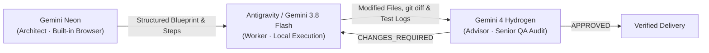

# Flux v2 — Architect, Worker, Advisor Skill for Antigravity

[](LICENSE)
[](SKILL.md)

**Author:** [XioDr](https://github.com/XioDr) · [AlacrityAgency](https://github.com/AlacrityAgency) · **License:** [Apache-2.0](LICENSE) · **[مستندات فارسی (Persian README)](README.fa.md)**

**`flux_v2`** is a native Antigravity skill implementing the three-stage **Architect – Worker – Advisor («معمار – کارگر – ناظر»)** workflow with zero external API keys:



---

## How It Works

1. **Phase 1 — Architect (`Gemini Neon` via Built-in Browser):**
   Gathers grounded workspace context, checks open tabs for an active `gemini.google.com` Neon session (or navigates to `https://gemini.google.com/app`), submits the structured Architect prompt, waits for full completion, and keeps the browser subagent idle for follow-up clarifications.
2. **Phase 2 — Worker (`Antigravity` / `gemini-3.8-flash-high`):**
   - If the active session is on **Gemini 3.8 Flash**, Antigravity executes Neon's blueprint directly as Worker.
   - If the active session is on **Gemini 4 Hydrogen** (or another model), it spawns a native `swarm` Worker pinned to `gemini-3.8-flash-high` in `workspace: "inherit"`.
   Implements files, runs builds/linters/tests locally, and produces an evidence-backed Execution Report (`git diff` + exact outputs).
3. **Phase 3 — Advisor (`Gemini 4 Hydrogen` / `gemini-4-hydrogen-xhigh`):**
   Independently inspects the modified files, `git diff`, and observed test proof against Neon's blueprint and original user requirements, iterating up to 3 review cycles (`CHANGES_REQUIRED` → fix & re-test → `APPROVED`).

---

## Repository Contents

```text
flux_v2/
├── SKILL.md                        # Core Antigravity skill protocol
├── references/
│   └── prompt-templates.md         # Neon, Worker, Hydrogen Advisor, and Revision templates
├── install.ps1                     # Windows one-command installer
├── install.sh                      # Linux / macOS one-command installer
├── LICENSE                         # Apache-2.0 (Copyright 2026 XioDr / Alacrity)
├── README.md                       # English documentation
└── README.fa.md                    # Persian documentation
```

---

## Installation

### Option A — Direct `git clone` into Antigravity Global Skills

```bash
git clone https://github.com/AlacrityAgency/flux_v2.git ~/.gemini/config/skills/flux_v2
```

On Windows PowerShell:

```powershell
git clone https://github.com/AlacrityAgency/flux_v2.git "$HOME\.gemini\config\skills\flux_v2"
```

### Option B — Clone Anywhere & Run Installer

**Windows (PowerShell):**

```powershell
git clone https://github.com/AlacrityAgency/flux_v2.git
cd flux_v2
.\install.ps1
```

**Linux / macOS:**

```bash
git clone https://github.com/AlacrityAgency/flux_v2.git
cd flux_v2
chmod +x install.sh
./install.sh
```

The installer copies `SKILL.md` and `references/` into `~/.gemini/config/skills/flux_v2`.

---

## Usage

Once installed, open Antigravity (with Gemini Neon ready in the built-in browser) and prompt:

> *"Use `flux_v2` to implement `<your complex task>`."*

---

Maintained by **[XioDr](https://github.com/XioDr)** at **[AlacrityAgency](https://github.com/AlacrityAgency)**.
